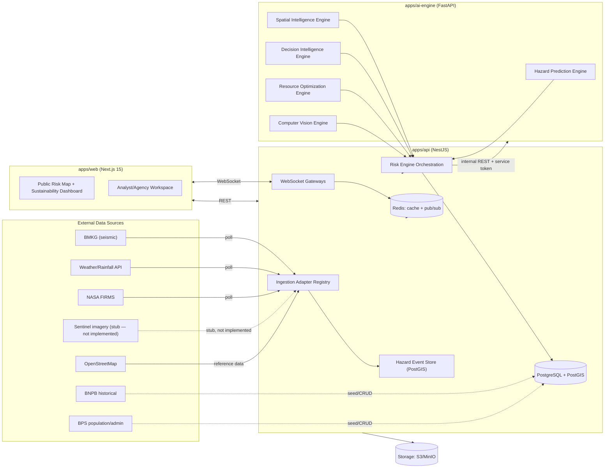
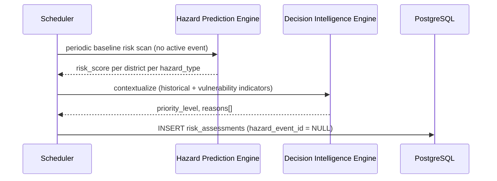

# AETHER — System Architecture

Baseline: `docs/SRS.md`. Monorepo, three apps, one logical system — same
three-tier separation ORION proved, restructured to remove ORION's polyrepo
hand-synced-types debt.

---

## 1. High-Level Architecture



**Invariants (carried over from ORION, do not weaken):**
- `apps/web` never calls `apps/ai-engine` directly — only `apps/api` does.
- `apps/ai-engine` never touches Postgres/Redis directly — stateless, pure
  function of the payload it's given.
- `apps/api` is the only service with external network egress.
- Auth boundary: end-user JWT validated only in `apps/api`. The
  `api → ai-engine` hop is secured by a separate static internal service token,
  not the user's JWT.

---

## 2. Sequence Diagrams

### 2.1 Hazard pipeline: event ingestion → decision recommendation

```mermaid
sequenceDiagram
    participant Src as External Source (e.g. BMKG)
    participant Ing as Ingestion Adapter
    participant HE as Hazard Events Module
    participant Spat as Spatial Intelligence Engine
    participant Pred as Hazard Prediction Engine
    participant Dec as Decision Intelligence Engine
    participant DB as PostgreSQL
    participant WS as WebSocket Gateway
    participant UI as apps/web

    Src->>Ing: poll / receive event
    Ing->>HE: validate + dedupe + normalize
    HE->>DB: INSERT hazard_events (+ *_details)
    HE->>Spat: resolve affected regions (ST_DWithin)
    Spat-->>HE: nearby district_ids[]
    HE->>DB: INSERT hazard_affected_regions
    Spat->>DB: check hazard_relationships (cascading?)
    HE->>WS: emit hazard_event.created
    WS-->>UI: push (map marker appears)

    par per affected district
        HE->>Pred: dispatch(hazard_event, district_id)
        Pred-->>HE: risk_score, exposure_level, confidence
        HE->>Dec: risk score + context
        Dec-->>HE: priority_level, reasons[], summary
        HE->>DB: INSERT risk_assessments, decision_recommendations
        HE->>WS: emit decision_recommendation.created
        WS-->>UI: push (decision panel updates)
    end

    Note over HE,Dec: If apps/ai-engine is unreachable, the hazard event stays<br/>visible; risk_assessment is marked status=failed and retried<br/>with backoff — ingestion is never blocked by engine downtime.
```

### 2.2 Standing/baseline risk scoring (the prediction/prevention differentiator)



This is the pipeline ORION never had — it never scored risk without an active
BMKG event. It's what makes AETHER a prediction/prevention platform rather than
a reactive one.

### 2.3 Auth flow (unchanged from ORION)

Login + refresh-rotation flow, JWT access (15m, in-memory)/refresh (7d, httpOnly
cookie) — identical pattern to ORION's `docs/ARCHITECTURE.md` §2.2.

---

## 3. Repository Layout

```
AETHER/
├─ apps/
│  ├─ web/            Next.js 15 App Router — see FOLDER_STRUCTURE in plan §2
│  ├─ api/             NestJS — modules in §3 below
│  └─ ai-engine/        FastAPI — router-per-engine, see §3 below
├─ packages/
│  ├─ contracts/        Shared TS types generated from apps/api's OpenAPI spec
│  └─ config/           Shared eslint/tsconfig/tailwind presets
├─ docs/
├─ infra/docker-compose.yml
└─ .github/workflows/
```

### 3.1 `apps/api` module list

`auth`, `users`, `roles`, `audit`, `redis`, `storage` (S3/MinIO-compatible,
new infra ORION never needed), `config`, `database` (reused near-verbatim) ·
`geo` (was `population`) · `hazard-events` (+ `earthquake/`, `landslide/`,
`flood/`, `wildfire/` sub-modules, all wired end-to-end) · `field-reports`
(citizen/field-reporter CV submission — new, no ORION equivalent) ·
`ingestion` (adapter registry: `bmkg`, `nasa_firms`, `weather_api` real;
`sentinel` a registered structural stub) · `risk-engine-orchestration` (was
`ai`, now includes `CvEngineClient` alongside `RiskEngineClient`) ·
`risk-assessments` (was `predictions`) · `decision-intelligence` (was
`recommendations`) · `spatial-intelligence` · `resource-optimization` ·
`sustainability` · `notifications` · `websocket` · `dashboard`.

### 3.2 `apps/ai-engine` router list

`hazard_prediction/` (per-hazard heuristic modules — earthquake, landslide,
flood, wildfire) · `spatial_intelligence/` · `decision_intelligence/` ·
`resource_optimization/` · `computer_vision/` (classical color/texture
heuristics — fire, smoke, flood, infra_damage — same v0-heuristic posture as
`hazard_prediction/`, not a trained model).

### 3.3 Local orchestration

`infra/docker-compose.yml` (single file, unlike ORION's parent-directory
compose file, since all apps live in one repo): `postgres` (postgis image),
`redis`, `ai-engine`, `api`, `web`.

---

## 4. Cross-app contract strategy

Unlike ORION (no shared package, hand-maintained matching TS types across 3
repos), AETHER generates `packages/contracts` from `apps/api`'s OpenAPI spec
(`openapi-typescript`) as a monorepo build step, consumed by `apps/web`. This
removes the drift risk ORION explicitly accepted as a trade-off for deploy
independence — a trade-off no longer needed once everything lives in one repo
with one CI pipeline gating merges. `apps/ai-engine`'s Pydantic schemas remain
its own source of truth for the `api ↔ ai-engine` contract, same as ORION.

---

## 5. Phase 2 — status

Flood + Forest Fire hazard types are fully wired: real `/predict-risk`
heuristics (`apps/ai-engine/app/ml/hazard_prediction/flood.py`/`wildfire.py`),
persistence through `hazard-events`, cross-hazard relationship rules
(landslide→flood, wildfire→flood, wildfire→landslide), and their own
`spatial-intelligence` proximity radii. The Computer Vision Engine
(`computer_vision/fire.py`/`smoke.py`/`flood.py`/`infra_damage.py`) is a
classical color/texture heuristic — deliberately not a trained model, same
v0-baseline posture as every hazard predictor here, since no labeled
disaster-imagery training set exists yet. The `storage/` module (S3/MinIO,
via `infra/docker-compose.yml`'s `minio`/`minio-init` services) backs both CV
image input and the new `field-reports` citizen-submission flow.

Two deliberate scope narrowings, both revisitable without an architecture
change:
- **NASA FIRMS and Weather/Rainfall adapters are real** (REST+API-key,
  `ingestion/adapters/nasa-firms.adapter.ts` / `weather.adapter.ts`).
  **Sentinel is a structural stub** (`sentinel.adapter.ts` — registered like
  a real adapter, `fetch()` always returns `[]`) — Sentinel Hub's OAuth2 +
  imagery-tile pipeline is disproportionate complexity for a source nothing
  downstream consumes yet.
- Baseline/standing risk scoring (§2.2) still can't score a district without
  a concrete event — there's no "typical conditions per hazard type per
  district" data source to synthesize one from. This predates Phase 2 (it
  affected earthquake/landslide too) and is now honestly surfaced rather than
  silently sending a malformed request: `RiskEngineOrchestrationService.
  buildHazardEventInput()` skips baseline attempts with a debug log instead
  of erroring.
