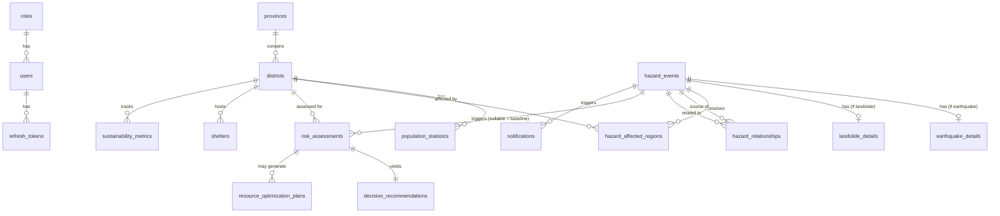

# AETHER — Database Schema

Target: PostgreSQL 16 + PostGIS 3.4, owned exclusively by `apps/api`. ORM: TypeORM
(same choice as ORION, migrations only, `synchronize: false`).

All tables use `uuid` primary keys except lookup tables, `created_at`/`updated_at`
timestamptz defaults, hard deletes + `audit_logs` (no soft-delete columns) — same
conventions as ORION's `docs/DATABASE_SCHEMA.md`.

```sql
CREATE EXTENSION IF NOT EXISTS "uuid-ossp";
CREATE EXTENSION IF NOT EXISTS "postgis";
```

---

## Reused near-verbatim from ORION

## 1. `roles`

```sql
CREATE TABLE roles (
    id          SMALLSERIAL PRIMARY KEY,
    name        VARCHAR(40) NOT NULL UNIQUE,  -- 'admin' | 'agency_operator' | 'analyst' | 'field_reporter'
    description TEXT
);

INSERT INTO roles (name, description) VALUES
    ('admin', 'Full system access'),
    ('agency_operator', 'Manages historical disaster records and resource plans'),
    ('analyst', 'Reviews risk assessments, decision recommendations, sustainability metrics'),
    ('field_reporter', 'Submits ground-truth reports and CV imagery (Phase 2)');
```

Role names differ from ORION's (`bnpb_operator`/`command_center_operator`) since
AETHER's roles reflect a risk-intelligence workflow, not command-center response —
same single-role-per-user model and `RolesGuard`/`@Roles()` enforcement pattern.

## 2. `users`

```sql
CREATE TABLE users (
    id            UUID PRIMARY KEY DEFAULT gen_random_uuid(),
    email         VARCHAR(255) NOT NULL UNIQUE,
    password_hash TEXT NOT NULL,
    full_name     VARCHAR(150) NOT NULL,
    role_id       SMALLINT NOT NULL REFERENCES roles(id),
    is_active     BOOLEAN NOT NULL DEFAULT true,
    last_login_at TIMESTAMPTZ,
    created_at    TIMESTAMPTZ NOT NULL DEFAULT now(),
    updated_at    TIMESTAMPTZ NOT NULL DEFAULT now()
);

CREATE INDEX idx_users_role ON users(role_id);
```

## 3. `refresh_tokens`

```sql
CREATE TABLE refresh_tokens (
    id          UUID PRIMARY KEY DEFAULT gen_random_uuid(),
    user_id     UUID NOT NULL REFERENCES users(id) ON DELETE CASCADE,
    token_hash  TEXT NOT NULL UNIQUE,
    expires_at  TIMESTAMPTZ NOT NULL,
    revoked_at  TIMESTAMPTZ,
    created_at  TIMESTAMPTZ NOT NULL DEFAULT now()
);

CREATE INDEX idx_refresh_tokens_user ON refresh_tokens(user_id);
```

## 4. `provinces`

```sql
CREATE TABLE provinces (
    id         UUID PRIMARY KEY DEFAULT gen_random_uuid(),
    bps_code   VARCHAR(10) NOT NULL UNIQUE,
    name       VARCHAR(120) NOT NULL,
    geom       GEOMETRY(MultiPolygon, 4326),
    created_at TIMESTAMPTZ NOT NULL DEFAULT now()
);

CREATE INDEX idx_provinces_geom ON provinces USING GIST (geom);
```

## 5. `districts`

Renamed conceptually to "regions" in product copy, kept as `districts` in schema
(same BPS administrative-code granularity ORION already validated).

```sql
CREATE TABLE districts (
    id           UUID PRIMARY KEY DEFAULT gen_random_uuid(),
    province_id  UUID NOT NULL REFERENCES provinces(id),
    bps_code     VARCHAR(10) NOT NULL UNIQUE,
    name         VARCHAR(120) NOT NULL,
    geom         GEOMETRY(Geometry, 4326) NOT NULL,
    area_km2     NUMERIC(12,2),
    created_at   TIMESTAMPTZ NOT NULL DEFAULT now()
);

CREATE INDEX idx_districts_geom ON districts USING GIST (geom);
CREATE INDEX idx_districts_province ON districts(province_id);
```

## 6. `population_statistics`

```sql
CREATE TABLE population_statistics (
    id                 UUID PRIMARY KEY DEFAULT gen_random_uuid(),
    district_id        UUID NOT NULL REFERENCES districts(id) ON DELETE CASCADE,
    year               SMALLINT NOT NULL,
    total_population   BIGINT NOT NULL,
    population_density NUMERIC(10,2) NOT NULL,
    source             VARCHAR(60) NOT NULL DEFAULT 'BPS',
    created_at         TIMESTAMPTZ NOT NULL DEFAULT now(),
    UNIQUE (district_id, year)
);

CREATE INDEX idx_population_district ON population_statistics(district_id);
```

## 7. `audit_logs`

```sql
CREATE TABLE audit_logs (
    id            UUID PRIMARY KEY DEFAULT gen_random_uuid(),
    actor_user_id UUID REFERENCES users(id),
    action        VARCHAR(80) NOT NULL,
    target_type   VARCHAR(60),
    target_id     UUID,
    metadata      JSONB,
    ip_address    INET,
    created_at    TIMESTAMPTZ NOT NULL DEFAULT now()
);

CREATE INDEX idx_audit_logs_actor ON audit_logs(actor_user_id);
CREATE INDEX idx_audit_logs_created ON audit_logs(created_at DESC);
```

---

## Generalized from ORION

## 8. `historical_disasters`

Adds `hazard_type` — becomes a cross-hazard historical record store instead of
BNPB-earthquake-only.

```sql
CREATE TYPE hazard_type AS ENUM ('earthquake', 'flood', 'landslide', 'wildfire');

CREATE TABLE historical_disasters (
    id                      UUID PRIMARY KEY DEFAULT gen_random_uuid(),
    hazard_type             hazard_type NOT NULL,
    province_id             UUID NOT NULL REFERENCES provinces(id),
    district_id             UUID REFERENCES districts(id),
    event_date              DATE NOT NULL,
    magnitude               NUMERIC(3,1),  -- earthquake only, nullable otherwise
    casualties_dead         INTEGER NOT NULL DEFAULT 0,
    casualties_injured      INTEGER NOT NULL DEFAULT 0,
    casualties_missing      INTEGER NOT NULL DEFAULT 0,
    displaced_population    INTEGER NOT NULL DEFAULT 0,
    damaged_buildings_count INTEGER NOT NULL DEFAULT 0,
    damage_description      TEXT,
    source                  VARCHAR(60) NOT NULL DEFAULT 'BNPB',
    created_by              UUID REFERENCES users(id),
    created_at              TIMESTAMPTZ NOT NULL DEFAULT now(),
    updated_at              TIMESTAMPTZ NOT NULL DEFAULT now()
);

CREATE INDEX idx_historical_hazard_type ON historical_disasters(hazard_type);
CREATE INDEX idx_historical_province ON historical_disasters(province_id);
CREATE INDEX idx_historical_district ON historical_disasters(district_id);
CREATE INDEX idx_historical_event_date ON historical_disasters(event_date DESC);
```

## 9. `notifications`

```sql
CREATE TYPE notification_type AS ENUM (
    'new_hazard_event', 'high_risk_assessment', 'hazard_relationship_detected', 'system'
);

CREATE TABLE notifications (
    id                       UUID PRIMARY KEY DEFAULT gen_random_uuid(),
    user_id                  UUID REFERENCES users(id) ON DELETE CASCADE,  -- NULL = broadcast
    type                     notification_type NOT NULL,
    title                    VARCHAR(200) NOT NULL,
    body                     TEXT,
    related_hazard_event_id  UUID REFERENCES hazard_events(id) ON DELETE CASCADE,
    related_recommendation_id UUID REFERENCES decision_recommendations(id) ON DELETE CASCADE,
    is_read                  BOOLEAN NOT NULL DEFAULT false,
    created_at               TIMESTAMPTZ NOT NULL DEFAULT now()
);

CREATE INDEX idx_notifications_user_unread ON notifications(user_id, is_read);
```

---

## Redesigned — the core multi-hazard generalization

## 10. `hazard_events`

Replaces ORION's single-purpose `earthquakes` table. One row per detected hazard
occurrence, hazard-agnostic core columns; hazard-specific data lives in the
`*_details` tables below (1:1).

```sql
CREATE TABLE hazard_events (
    id              UUID PRIMARY KEY DEFAULT gen_random_uuid(),
    hazard_type     hazard_type NOT NULL,
    external_id     VARCHAR(100),               -- source's own id, for dedupe
    latitude        NUMERIC(9,6) NOT NULL CHECK (latitude BETWEEN -90 AND 90),
    longitude       NUMERIC(9,6) NOT NULL CHECK (longitude BETWEEN -180 AND 180),
    geom            GEOMETRY(Point, 4326) NOT NULL,
    location_label  VARCHAR(255),
    region          VARCHAR(120),
    event_time      TIMESTAMPTZ NOT NULL,
    source          VARCHAR(60) NOT NULL,        -- 'bmkg_autogempa' | 'weather_api' | 'nasa_firms' | 'manual' | ...
    raw_payload     JSONB NOT NULL,
    created_at      TIMESTAMPTZ NOT NULL DEFAULT now(),

    CONSTRAINT uq_hazard_event_dedupe UNIQUE (external_id, source)
);

CREATE INDEX idx_hazard_events_geom ON hazard_events USING GIST (geom);
CREATE INDEX idx_hazard_events_type ON hazard_events(hazard_type);
CREATE INDEX idx_hazard_events_event_time ON hazard_events(event_time DESC);
```

Same redundant `geom`+`latitude`/`longitude` pattern as ORION (geom for PostGIS
spatial queries, lat/lon for direct API/UI use), same dedupe discipline
(`external_id`+`source` unique, plus app-level time+distance tolerance check for
sources without a stable external id).

## 11. `earthquake_details`

```sql
CREATE TABLE earthquake_details (
    hazard_event_id   UUID PRIMARY KEY REFERENCES hazard_events(id) ON DELETE CASCADE,
    magnitude         NUMERIC(3,1) NOT NULL CHECK (magnitude > 0 AND magnitude < 10),
    depth_km          NUMERIC(6,1) NOT NULL CHECK (depth_km >= 0),
    potential_tsunami BOOLEAN NOT NULL DEFAULT false
);
```

## 12. `landslide_details`

```sql
CREATE TABLE landslide_details (
    hazard_event_id   UUID PRIMARY KEY REFERENCES hazard_events(id) ON DELETE CASCADE,
    slope_degrees     NUMERIC(5,2),
    soil_saturation   NUMERIC(4,3),   -- 0.000-1.000
    triggering_rainfall_mm NUMERIC(7,2)
);
```

## 13. `flood_details` (Phase 2)

```sql
CREATE TABLE flood_details (
    hazard_event_id     UUID PRIMARY KEY REFERENCES hazard_events(id) ON DELETE CASCADE,
    rainfall_mm         NUMERIC(7,2),
    water_level_m       NUMERIC(6,2),
    river_basin         VARCHAR(120),
    flood_hazard_index  NUMERIC(4,3)  -- BNPB InaRISK INDEKS_BAHAYA_BANJIR, 0-1, per-coordinate lookup
);
```

## 14. `wildfire_details` (Phase 2)

```sql
CREATE TABLE wildfire_details (
    hazard_event_id   UUID PRIMARY KEY REFERENCES hazard_events(id) ON DELETE CASCADE,
    frp_confidence    NUMERIC(4,3),   -- FIRMS fire radiative power confidence, 0-1
    hotspot_count     INTEGER,
    brightness_kelvin NUMERIC(7,2)
);
```

## 15. `hazard_affected_regions`

Replaces `earthquake_affected_districts` — same spatial-resolution audit trail,
now hazard-agnostic.

```sql
CREATE TABLE hazard_affected_regions (
    id              UUID PRIMARY KEY DEFAULT gen_random_uuid(),
    hazard_event_id UUID NOT NULL REFERENCES hazard_events(id) ON DELETE CASCADE,
    district_id     UUID NOT NULL REFERENCES districts(id),
    distance_km     NUMERIC(8,2) NOT NULL,
    created_at      TIMESTAMPTZ NOT NULL DEFAULT now(),
    UNIQUE (hazard_event_id, district_id)
);

CREATE INDEX idx_har_hazard_event ON hazard_affected_regions(hazard_event_id);
CREATE INDEX idx_har_district ON hazard_affected_regions(district_id);
```

Same resolution rule pattern as ORION (radius derived from severity, e.g. for
earthquake `radius_km = 50 * (magnitude - 4.0)` clamped `[20, 300]`; landslide
uses a smaller fixed-radius default since it's more localized), computed via:

```sql
SELECT d.id, ST_Distance(d.geom::geography, e.geom::geography) / 1000 AS distance_km
FROM districts d, hazard_events e
WHERE e.id = :hazard_event_id
  AND ST_DWithin(d.geom::geography, e.geom::geography, :radius_meters);
```

## 16. `hazard_relationships`

**New** — the direct implementation of "model relationships between hazards
instead of treating them independently." Written by the Spatial Intelligence
Engine when it detects a plausible cascading link (e.g. an earthquake followed
by a landslide in the same region within a correlation window).

```sql
CREATE TYPE hazard_relationship_type AS ENUM ('triggers', 'exacerbates', 'coincides');

CREATE TABLE hazard_relationships (
    id                UUID PRIMARY KEY DEFAULT gen_random_uuid(),
    source_event_id   UUID NOT NULL REFERENCES hazard_events(id) ON DELETE CASCADE,
    related_event_id  UUID NOT NULL REFERENCES hazard_events(id) ON DELETE CASCADE,
    relationship_type hazard_relationship_type NOT NULL,
    confidence_score  NUMERIC(4,3) NOT NULL,
    detected_by       VARCHAR(60) NOT NULL DEFAULT 'spatial_intelligence_engine',
    created_at        TIMESTAMPTZ NOT NULL DEFAULT now(),
    UNIQUE (source_event_id, related_event_id, relationship_type)
);

CREATE INDEX idx_hazard_rel_source ON hazard_relationships(source_event_id);
CREATE INDEX idx_hazard_rel_related ON hazard_relationships(related_event_id);
```

## 17. `risk_assessments`

Replaces `predictions`. `hazard_event_id` is **nullable** — null means a
standing/baseline periodic risk score for a region with no active event, the
core prediction/prevention differentiator vs. ORION's reactive-only model.

```sql
CREATE TYPE exposure_level AS ENUM ('low', 'moderate', 'high', 'severe');
CREATE TYPE risk_assessment_status AS ENUM ('pending', 'completed', 'failed');

CREATE TABLE risk_assessments (
    id                  UUID PRIMARY KEY DEFAULT gen_random_uuid(),
    hazard_event_id     UUID REFERENCES hazard_events(id) ON DELETE CASCADE,
    hazard_type         hazard_type NOT NULL,
    district_id         UUID NOT NULL REFERENCES districts(id),
    risk_score          NUMERIC(5,2) NOT NULL,   -- 0-100
    exposure_level      exposure_level,
    estimated_affected_population BIGINT,
    confidence_score    NUMERIC(4,3),
    model_version       VARCHAR(40),
    input_snapshot      JSONB NOT NULL,           -- exact payload sent to ai-engine (auditability)
    status               risk_assessment_status NOT NULL DEFAULT 'pending',
    error_message        TEXT,
    assessed_at          TIMESTAMPTZ NOT NULL DEFAULT now(),
    created_at           TIMESTAMPTZ NOT NULL DEFAULT now(),
    updated_at           TIMESTAMPTZ NOT NULL DEFAULT now()
);

CREATE INDEX idx_risk_assessments_hazard_event ON risk_assessments(hazard_event_id);
CREATE INDEX idx_risk_assessments_district ON risk_assessments(district_id);
CREATE INDEX idx_risk_assessments_status ON risk_assessments(status);
-- Baseline (event-triggered = NULL) assessments are periodic; this index serves
-- "latest baseline risk per district" lookups.
CREATE INDEX idx_risk_assessments_baseline ON risk_assessments(district_id, assessed_at DESC)
    WHERE hazard_event_id IS NULL;
```

## 18. `decision_recommendations`

Replaces `recommendations`. Same structured `reasons` JSONB XAI pattern; now
carries cascading-hazard factors.

```sql
CREATE TYPE priority_level AS ENUM ('low', 'medium', 'high', 'critical');

CREATE TABLE decision_recommendations (
    id                UUID PRIMARY KEY DEFAULT gen_random_uuid(),
    risk_assessment_id UUID NOT NULL REFERENCES risk_assessments(id) ON DELETE CASCADE,
    priority_level    priority_level NOT NULL,
    priority_score    NUMERIC(5,2) NOT NULL,
    confidence_score  NUMERIC(4,3) NOT NULL,
    summary_text      TEXT NOT NULL,
    reasons           JSONB NOT NULL,  -- [{ "factor": "...", "detail": "...", "weight": 0.3 }, ...]
    action_recommendation TEXT,
    created_at        TIMESTAMPTZ NOT NULL DEFAULT now(),
    UNIQUE (risk_assessment_id)
);

CREATE INDEX idx_decision_rec_priority ON decision_recommendations(priority_level, priority_score DESC);
```

## 19. `vulnerability_indicators` (Phase 2 candidate, schema included now)

Per-region infrastructure/social vulnerability inputs feeding exposure analysis.

```sql
CREATE TABLE vulnerability_indicators (
    id                UUID PRIMARY KEY DEFAULT gen_random_uuid(),
    district_id       UUID NOT NULL REFERENCES districts(id) ON DELETE CASCADE,
    indicator_type    VARCHAR(80) NOT NULL,  -- 'building_quality' | 'healthcare_access' | 'poverty_rate' | ...
    value             NUMERIC(10,4) NOT NULL,
    unit              VARCHAR(40),
    year              SMALLINT NOT NULL,
    source            VARCHAR(60),
    created_at        TIMESTAMPTZ NOT NULL DEFAULT now(),
    UNIQUE (district_id, indicator_type, year)
);

CREATE INDEX idx_vuln_indicators_district ON vulnerability_indicators(district_id);
```

## 20. `resource_optimization_plans`

Evolves ORION's `hospitals`/`resource_estimates` pattern into evacuation/
logistics/shelter planning.

```sql
CREATE TABLE resource_optimization_plans (
    id               UUID PRIMARY KEY DEFAULT gen_random_uuid(),
    district_id      UUID NOT NULL REFERENCES districts(id),
    hazard_event_id  UUID REFERENCES hazard_events(id) ON DELETE CASCADE,
    risk_assessment_id UUID REFERENCES risk_assessments(id) ON DELETE CASCADE,
    plan_type        VARCHAR(60) NOT NULL,  -- 'evacuation' | 'shelter_allocation' | 'logistics'
    plan_details     JSONB NOT NULL,        -- routes, capacities, resource breakdown
    estimated_personnel_needed INTEGER,
    status           VARCHAR(40) NOT NULL DEFAULT 'draft',
    created_at       TIMESTAMPTZ NOT NULL DEFAULT now(),
    updated_at       TIMESTAMPTZ NOT NULL DEFAULT now()
);

CREATE INDEX idx_resource_plans_district ON resource_optimization_plans(district_id);
CREATE INDEX idx_resource_plans_hazard_event ON resource_optimization_plans(hazard_event_id);
```

## 21. `shelters`

```sql
CREATE TABLE shelters (
    id                UUID PRIMARY KEY DEFAULT gen_random_uuid(),
    district_id       UUID NOT NULL REFERENCES districts(id),
    name              VARCHAR(200) NOT NULL,
    geom              GEOMETRY(Point, 4326) NOT NULL,
    capacity          INTEGER NOT NULL,
    current_occupancy INTEGER NOT NULL DEFAULT 0,
    created_at        TIMESTAMPTZ NOT NULL DEFAULT now(),
    updated_at        TIMESTAMPTZ NOT NULL DEFAULT now()
);

CREATE INDEX idx_shelters_geom ON shelters USING GIST (geom);
CREATE INDEX idx_shelters_district ON shelters(district_id);
```

## 22. `cv_detections` (Phase 2 — Computer Vision Engine)

```sql
CREATE TYPE cv_detection_type AS ENUM ('flood', 'smoke', 'fire', 'infra_damage');

CREATE TABLE cv_detections (
    id                UUID PRIMARY KEY DEFAULT gen_random_uuid(),
    detection_type    cv_detection_type NOT NULL,
    hazard_event_id   UUID REFERENCES hazard_events(id) ON DELETE CASCADE,
    source_image_ref  TEXT NOT NULL,   -- storage key (S3/MinIO), see MIGRATION doc §storage
    bounding_boxes    JSONB NOT NULL,
    confidence_score  NUMERIC(4,3) NOT NULL,
    created_at        TIMESTAMPTZ NOT NULL DEFAULT now()
);

CREATE INDEX idx_cv_detections_hazard_event ON cv_detections(hazard_event_id);
CREATE INDEX idx_cv_detections_type ON cv_detections(detection_type);
```

## 23. `sustainability_metrics`

```sql
CREATE TABLE sustainability_metrics (
    id                          UUID PRIMARY KEY DEFAULT gen_random_uuid(),
    district_id                 UUID NOT NULL REFERENCES districts(id),
    period_start                DATE NOT NULL,
    period_end                  DATE NOT NULL,
    sdg_indicators               JSONB NOT NULL DEFAULT '{}',
    climate_resilience_score    NUMERIC(5,2),
    carbon_reduction_estimate   NUMERIC(12,2),
    protected_population         BIGINT,
    response_efficiency_score   NUMERIC(5,2),
    created_at                   TIMESTAMPTZ NOT NULL DEFAULT now(),
    UNIQUE (district_id, period_start, period_end)
);

CREATE INDEX idx_sustainability_district ON sustainability_metrics(district_id);
```

## 24. `data_source_syncs`

Generalizes ORION's hospitals-sync tracking pattern to every ingestion adapter.

```sql
CREATE TABLE data_source_syncs (
    id             UUID PRIMARY KEY DEFAULT gen_random_uuid(),
    source_id      VARCHAR(60) NOT NULL UNIQUE,  -- 'bmkg' | 'weather_api' | 'nasa_firms' | 'sentinel' | 'osm'
    last_synced_at TIMESTAMPTZ,
    status         VARCHAR(40) NOT NULL DEFAULT 'never_run',
    error_message  TEXT,
    updated_at     TIMESTAMPTZ NOT NULL DEFAULT now()
);
```

---

## ER Overview (Phase 1 slice: Earthquake + Landslide)



Next: `docs/API_SPEC.md`, `docs/ARCHITECTURE.md`, `docs/MIGRATION_FROM_ORION.md`.
